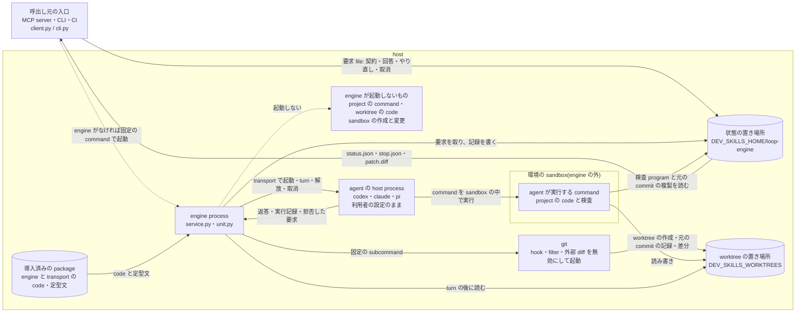
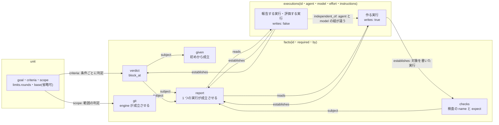
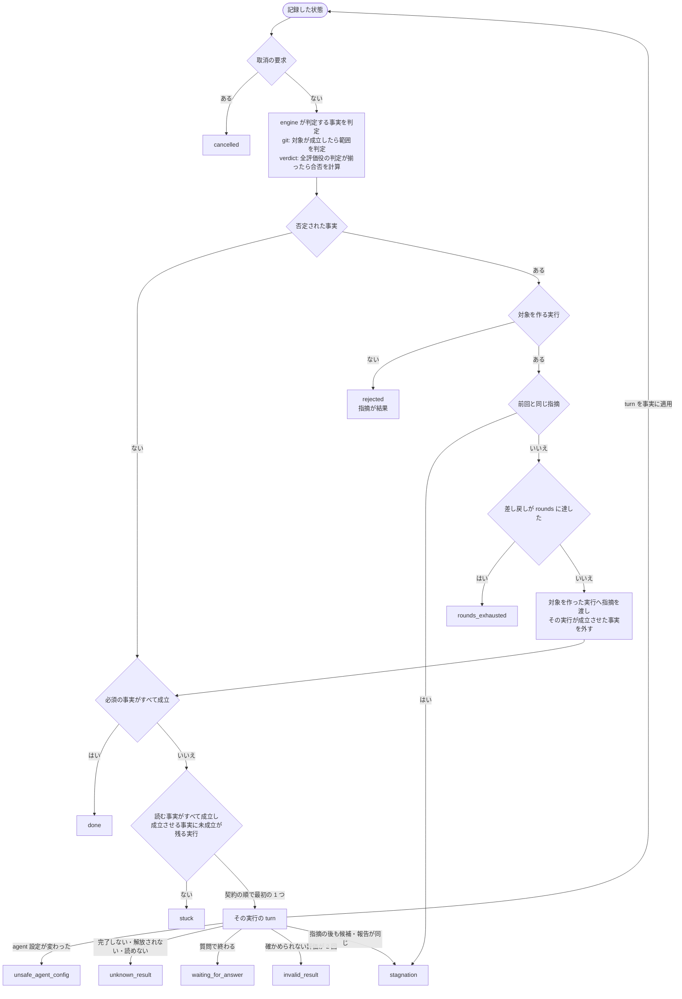
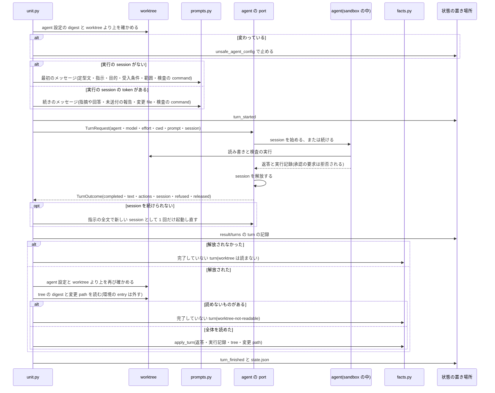
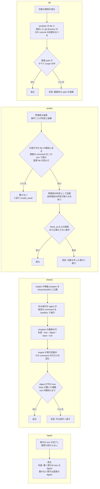
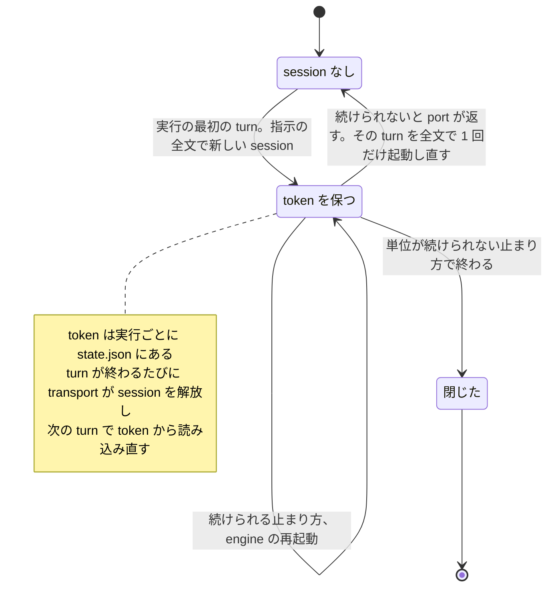
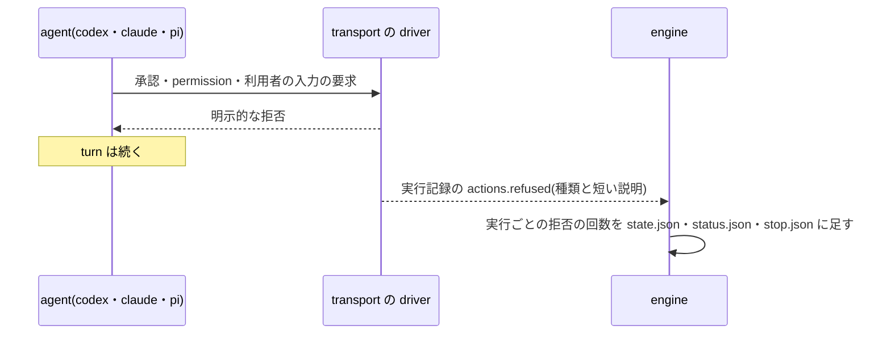
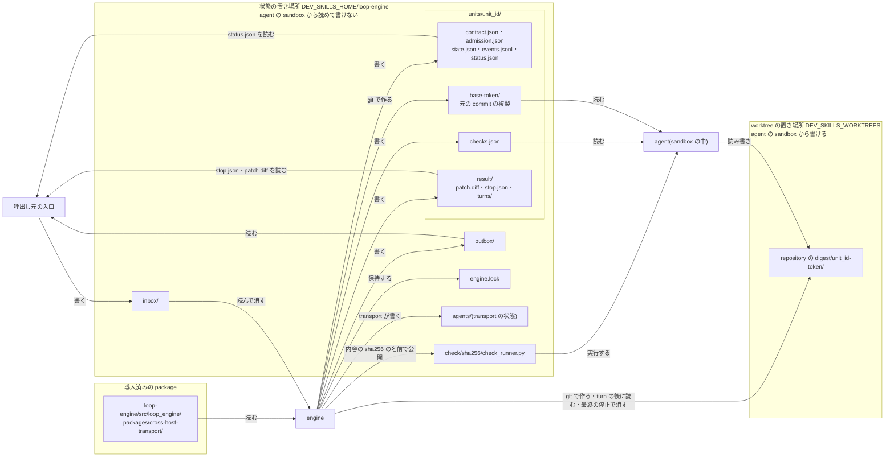

# Loop Engine の技術アーキテクチャ

Loop Engine は、委任された 1 単位の作業を、契約にある必須の事実がすべて成立するか、止まる理由が生じるまで host 上で進める。作る・機械検査する・独立に評価する作業は agent が自分の sandbox の中で行い、engine は次の実行の選択、事実の判定、記録だけを持つ。engine が受け取るのは契約(成立させる事実と、それを成立させられる実行)だけで、契約を作った側の概念(役の名前、判断知識、skill)を知らない。

本文書は全体像と核心の境界を示す。module、契約の field、記録の file、終了コードの詳細は [docs/architecture.md](docs/architecture.md)、決定の理由と比較した案は [docs/adr/](docs/adr/) にある。

## 境界



engine が起動する process は git と、transport の対応表にある agent の起動 command だけであり、project の code が動くのは agent の sandbox の中だけである。

- 入口は要求を file で渡し、engine の記録を読むだけで、進行・判定・記録の処理を持たない。engine process が動いていなければ、入口が固定の command(`python -I` で engine の main)で起動する。
- engine は 1 つの状態の置き場所につき 1 つの process で、単位ごとに thread を持つ。止まっても、次の engine が記録から続ける。
- agent の起動は `composition.py` だけが transport に接続する。engine の core は `agents.py` の port(turn の実行、session の終了、全体の停止)だけに依存する。

## 単位の宣言



契約に実行の順番はなく、事実と実行の参照(`reads`、`establishes`、`subject`、`independent_of`)だけがある。この構造は engine が定義し(`facts.py` の `validate`)、受付時に検査して、合わない契約を受け付けない。新しい種類の単位は、この節の規則を満たす契約を書けば engine で動く。

### 契約の形

```
unit_id, repository(repository の最上位の絶対 path)
unit:        goal, criteria[{id, text}], scope[path], limits{rounds}
             任意: base(commit id)、allow_same_model(bool)、examine_min(0..1)
facts:       {id, required, by} と by ごとの項目
executions:  {id, agent, model, effort, instructions, reads, establishes, writes, independent_of}
```

- `unit.goal` と `criteria` は全実行の指示に入る。評価役は `criteria` の条件ごとに判定する。`scope` は `git` の事実が判定する変更してよい path で、作る役にも示される。`limits.rounds` は差し戻しの上限である。
- `unit.base` を指定すると、その commit から repository の現在の commit までの既存の変更を対象にする(現在の commit は `base` の子孫でなければならない)。省略すると現在の commit が元の commit になる。
- `allow_same_model` は `independent_of` の検査を緩める。`examine_min` は、評価役の実行記録が読んだことを示さなければならない変更 file の割合で、既定は 1 である。

### 事実の種類

| `by` | 項目 | 成立させる実行 | 成立のさせ方 |
|---|---|---|---|
| `given` | なし | 持たない | 初めから成立する。内容は今の tree の digest で、これを対象にした事実は tree が変わると未成立に戻る |
| `report` | なし | ちょうど 1 つ | その実行の turn が完了したとき |
| `checks` | `subject`、`checks[{name, expect}]` | `subject` を成立させる実行と同じ集合で、すべて `writes: true` | その実行の実行記録にある検査の状態の行 |
| `verdict` | `subject`、`block_at`(`minor`・`major`・`blocker`) | 1 つ以上(評価役) | 全評価役の判定から engine が計算 |
| `git` | `subject` | 持たない | `subject` が成立した後、変更 path を `scope` と比べる |

- `checks` の `expect` は `pass`(候補で通る)か `fails_on_base`(元の commit に候補の test だけを入れて落ちる)である。名前は元の commit の `.dev-skills/checks.json` に定義がなければならず、`fails_on_base` の検査は `test_paths` を持たなければならない。
- `required: false` の事実は完了の条件に入らず、ほかの事実の対象や読む事実にはなれる。

### 実行の規則

- `agent` は導入済みの対応表にある名前、`model` と `effort` は名前か `null` である。engine はこれらの値で agent を起動し、解釈しない。
- `establishes` は 1 つ以上で、`reads` と重ならない。参照する事実と実行はすべて契約にある。
- `writes: true` の実行だけが worktree を変えてよい。書かない実行の turn が差分を変えれば、その turn は完了しない。
- `independent_of` に挙げた実行とは、`unit.allow_same_model` が真でない限り、agent と model の組が違わなければならない。
- 事実の依存(対象と、その事実を成立させる実行が読む事実)は循環してはならない。`checks` の事実の依存は対象だけである。

### 例

```json
{"facts": [
  {"id": "a", "required": true, "by": "report"},
  {"id": "b", "required": true, "by": "verdict", "subject": "a", "block_at": "major"}],
 "executions": [
  {"id": "x", "agent": "codex", "model": null, "effort": null, "instructions": "…",
   "reads": [], "establishes": ["a"], "writes": false, "independent_of": []},
  {"id": "y", "agent": "claude", "model": null, "effort": null, "instructions": "…",
   "reads": ["a"], "establishes": ["b"], "writes": false, "independent_of": ["x"]}]}
```

x が報告 a を書き、x と独立な y が a を評価して b を成立させる。b が否定されると、指摘は a を作った x へ戻り、a は外される。x の次の turn で a が再び成立すると、b は新しい a を根拠に判定し直される(指摘の後も報告が変わらなければ `stagnation`)。大きさと文字種の上限は [docs/architecture.md#契約](docs/architecture.md#契約) にある。

## 次の実行の選択と止まり方



事実は、判定したときの根拠(対象と読んだ事実の内容)が今と同じ間だけ成立し、根拠が変われば自動的に未成立に戻るので、engine は工程を持たずに次の実行を導く。続けられる止まり方は `waiting_for_answer`(回答)、`unknown_result` と `invalid_result`(やり直し)だけで、ほかは最終である([止まり方と終了コード](docs/architecture.md#止まり方と終了コード))。

## 1 turn



engine が worktree を判定するのは、port が agent の session を解放して turn を返した後だけであり、読めないものが 1 つでもある tree では何も判定しない。書かない実行の turn では、git が記録する差分を turn の前後で比べ、変わっていれば完了として扱わない。詳細は [turn の終わりと worktree](docs/architecture.md#turn-の終わりと-worktree) と [環境の entry](docs/architecture.md#環境の-entry) にある。

## 事実の成立



どの事実も、agent の自己申告ではなく engine が確かめられるもの(engine の置いた program の状態の行、引用と実行記録、git の記録)で成立する。評価役は承認を宣言せず、合否は engine が計算する。検査の command と状態の行は [検査](docs/architecture.md#検査)、元の commit の扱いは [元の commit](docs/architecture.md#元の-commit) にある。

## agent の session と承認の要求





session は実行ごとに 1 つで、ほかの実行(評価役と作る役を含む)と共有しない。承認の要求は 3 つの agent で同じく拒否され、単位は止まらない。拒否されて実行できなかった検査は合格の行を残さないので、その事実は成立しない。詳細は [agent の session](docs/architecture.md#agent-の-session) と [承認の要求](docs/architecture.md#承認の要求) にある。

## 置き場所と書き手



agent が書ける場所は worktree の置き場所だけで、判定に使うもの(検査 program、元の commit の複製、記録)はすべて agent が書けない状態の置き場所にある。この読み書きの区別を守るのは環境の sandbox 設定であり、engine は前提とするだけである。file の内容は [記録](docs/architecture.md#記録) にある。

## 信頼の境界

engine が確かめるもの:

- 契約は受付時に形と参照を検査し、agent 名、model、effort は固定の文字種に限る。agent は導入済みの対応表にあるものだけを受け付け、engine 自身の code を含む repository は受け付けない。
- 検査の定義は元の commit の `.dev-skills/checks.json` を git から読む。範囲と変更 path は、worktree を作った時点で読んだ git directory にある元の commit の記録と比べ、agent が書ける tree から元の内容を読まない。
- 各 turn の前後で、worktree の agent 設定(`.claude`、`.codex`、`.pi`、`.agents`、`.mcp.json`)の digest と、worktree より上に engine が作ったもの以外がないことを確かめる。
- 検査 program は名前を渡す前に、内容が directory 名の sha256 と一致することを確かめる。状態の行は今の tree の digest と、engine が置いた元の commit の複製の digest に結び付ける。
- 評価役の引用は今の file か判定対象の報告に、根拠の command はその turn の実行記録にあることを確かめる。評価する実行と、それが独立すべき実行は、契約が許さない限り agent と model の組が違う。
- session の解放を確かめられない turn と、全体を読めない worktree では何も判定しない。
- 環境が worktree の最上位に置く空の読み取り専用 file(どちらの commit にもない名前)だけは変更として数えず、外した名前を記録する。worktree の中のものは削除も変更もしない。

engine が確かめずに環境に頼るもの:

- agent の sandbox が有効であること、状態の置き場所と engine の Python を読めて状態の置き場所に書けないこと。
- 確認と agent の起動の間に別の agent が worktree の置き場所へ file を置かないこと。
- 検査 program が複製を写した後の、sandbox の中での test の振る舞い。
- agent の実行記録は transport が provider から受け取ったものであり、engine はそれを agent の報告文の代わりに使う。

## 決定

| 決定 | ADR |
|---|---|
| engine は host で動き sandbox を持たず、git と agent の command だけを起動する | [adr-20261114-loop-engine-host-boundary](docs/adr/adr-20261114-loop-engine-host-boundary.md) |
| 単位の完了は事実の成立で決め、次の実行は契約のデータから導く | [adr-20261114-unit-completes-when-facts-hold](docs/adr/adr-20261114-unit-completes-when-facts-hold.md) |
| 検査は agent が sandbox の中で実行し、engine は実行記録で判定する | [adr-20261114-checks-judged-from-execution-record](docs/adr/adr-20261114-checks-judged-from-execution-record.md) |
| 評価の合否は engine が計算し、確かめられる結果だけを数える | [adr-20261114-verdict-computed-from-checkable-findings](docs/adr/adr-20261114-verdict-computed-from-checkable-findings.md) |
| 実行は自分の session を続け、承認の要求は拒否して turn を続ける | [adr-20261114-agent-sessions-continue-and-approvals-are-refused](docs/adr/adr-20261114-agent-sessions-continue-and-approvals-are-refused.md) |
| 環境が置く空の読み取り専用 file は役の変更として数えない | [adr-20261115-environment-entries-are-not-changes](docs/adr/adr-20261115-environment-entries-are-not-changes.md) |
