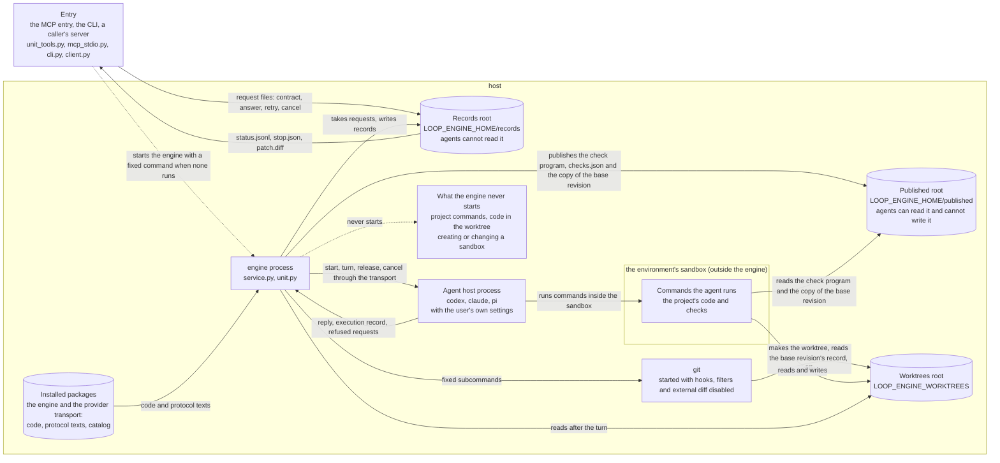
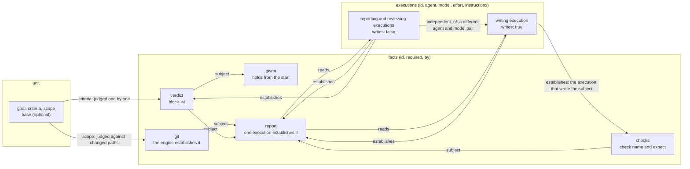
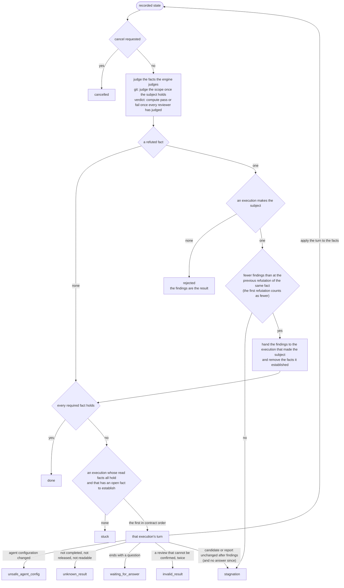
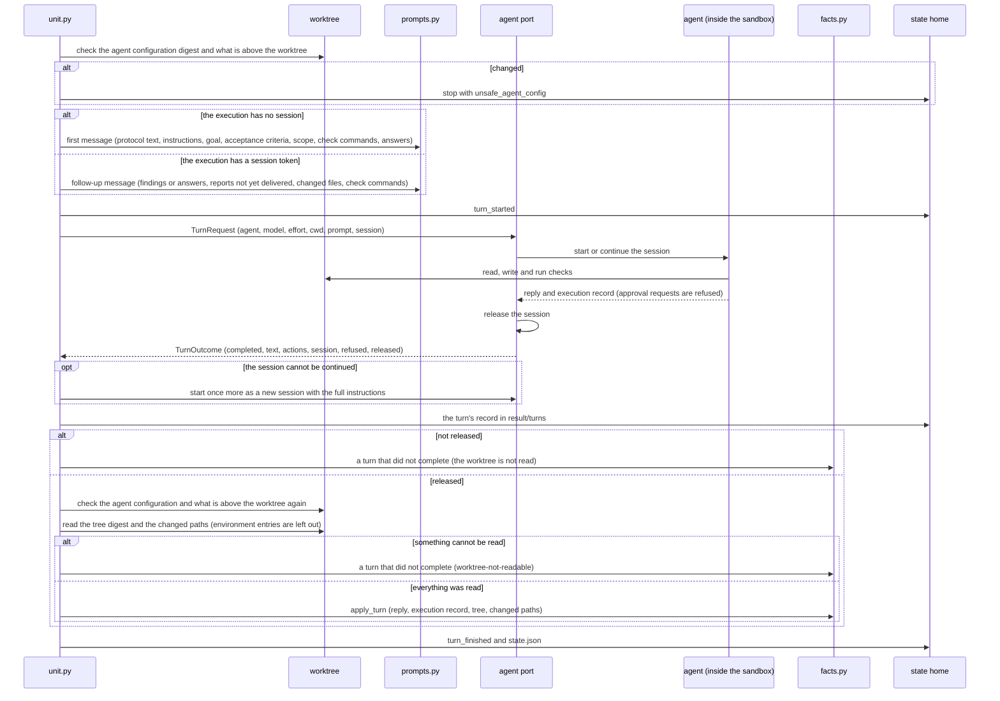
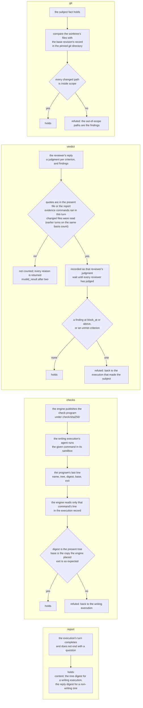
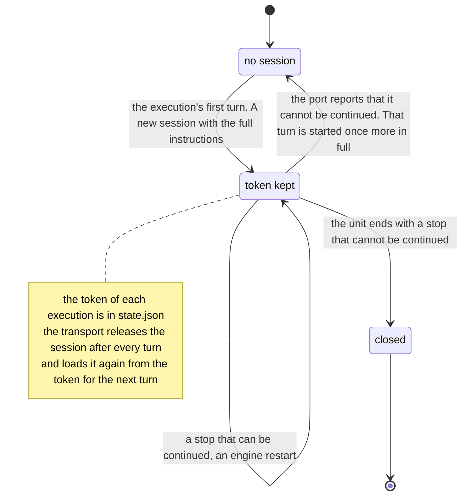
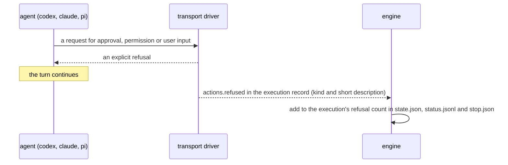
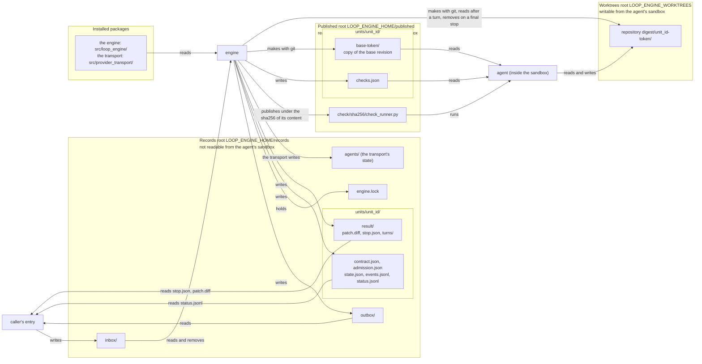

# Loop Engine architecture

Loop Engine carries one delegated unit of work on a host until every required fact in its contract holds or a reason to stop arises. Agents make, check and independently review inside their own sandbox. The engine holds only the choice of the next execution, the judgment of facts and the records. The engine receives nothing but the contract (the facts to establish and the executions that can establish them) and knows no concept of the side that wrote it: no role names, no judgment knowledge, no skills.

This document is for people who change or review the engine. It shows the whole and the boundaries that matter. What a caller can rely on is in [Product](PRODUCT.md). Modules, contract limits, record files and exit codes are in the [technical reference](docs/architecture.md). The reasons for each decision and the alternatives considered are in [docs/adr/](docs/adr/).

## Boundary



The only processes the engine starts are git and the agent start commands in the transport's catalog. Project code runs only inside an agent's sandbox. The rules that keep this boundary are the [design principles](#design-principles) below.

## Design principles

The rules that the engine's implementation and every change to it keep. The ADR that decided each rule is in parentheses.

- **What it starts**: The engine starts only git (with arguments that disable hooks, filters and external diff) and the agent start commands in the installed catalog. It does not run project commands (tests, builds, scripts); agents run them inside their own sandbox. Neither LLM output nor project content decides a program, an argument or a setting that runs on the host. ([host boundary](docs/adr/adr-20261114-loop-engine-host-boundary.md), item 3)
- **Sandbox**: The engine does not create, check or change a sandbox. It passes no sandbox or approval setting to the agents it starts and starts them with the user's own settings. It refuses approval requests and lets the turn continue; it has no path to approve. ([host boundary](docs/adr/adr-20261114-loop-engine-host-boundary.md), item 2; [sessions and approvals](docs/adr/adr-20261114-agent-sessions-continue-and-approvals-are-refused.md), item 7)
- **Shape of the process**: The engine is fixed code that runs on the host, in a process separate from the caller's entry (server, CLI). One process per state home runs many units, with one thread per unit and no process per unit. ([host boundary](docs/adr/adr-20261114-loop-engine-host-boundary.md), item 1)
- **Entry**: An entry hands over requests as files and reads the engine's records. It has no progress, judgment or recording logic. When no engine process is running, the entry starts one with a fixed command (the engine's main under `python -I`). In CI the CLI waits until the unit stops and receives the stop reason as an exit code. A session uses the unit tools, which the engine provides with a stdio MCP server on the standard library alone; a caller that builds contracts mounts the tools in its own server and replaces only the start. ([host boundary](docs/adr/adr-20261114-loop-engine-host-boundary.md), item 1; [MCP entry decision](docs/adr/adr-20261117-engine-provides-the-unit-tools-and-mcp-entry.md))
- **Connections**: The unit tools serve one connection, a session's directory. A start is accepted only for a repository inside it, a unit another connection started does not exist for it, and the entry does not open for an agent the engine started or when the records lie inside the connection. No tool takes a program, an argument list, an environment, a path or the state home. ([MCP entry decision](docs/adr/adr-20261117-engine-provides-the-unit-tools-and-mcp-entry.md), items 1 and 2)
- **Continuing and resuming**: The engine carries a running unit on after the entry's connection or the caller's conversation ends. When the engine stops, the next start continues from the record (`state.json`). ([host boundary](docs/adr/adr-20261114-loop-engine-host-boundary.md), item 1 and its consequences)
- **State home and its writer**: State lives in the state home (under `LOOP_ENGINE_HOME`, by default `~/.loop-engine`), and only the engine's process writes it (`agents/` is written by the transport inside the engine's process). Contracts, answers, retries and cancellations arrive from the entry as data. The home, its environment variables and the project's check file carry the engine's name and no caller's. ([host boundary](docs/adr/adr-20261114-loop-engine-host-boundary.md), item 6; [engine names](docs/adr/adr-20261117-engine-names-its-own-home-and-check-file.md))
- **Records and what is published**: What agents read (the check program, the unit's `checks.json`, the copy of the base revision) goes to the published root (`published/`); every other record goes to the records root (`records/`). Paths handed to a role point only into the published root. What makes the records unreadable to agents is the environment's sandbox settings. ([records decision](docs/adr/adr-20261116-engine-records-apart-from-what-agents-read.md); [engine names](docs/adr/adr-20261117-engine-names-its-own-home-and-check-file.md), item 2)
- **When work stops going back**: A refuted fact goes back to the execution that makes its subject only when the findings are fewer than at the previous refutation of the same fact. Otherwise the unit stops with `stagnation`. There is no limit on the number of rounds. ([convergence decision](docs/adr/adr-20261116-work-goes-back-while-it-converges.md))
- **Answers**: The requester's answers stay in the unit's state and every execution receives them. A verdict fact has the answers at the time of its judgment in its basis. ([answers decision](docs/adr/adr-20261116-answers-reach-every-execution.md))
- **Decisions on values only**: The decision logic (`facts.py`) and prompt assembly (`prompts.py`) work on values only, with no I/O, clock, randomness, process or global execution context. The modules that act (`unit.py`, `service.py`, the entries) observe and record; what a turn's result means, which execution runs next and why a unit stops are decided in `facts.py`. State can be saved as JSON, read back and carried on from there. ([completion by facts](docs/adr/adr-20261114-unit-completes-when-facts-hold.md), item 8; [pure prompts and unconfirmed results](docs/adr/adr-20261115-prompts-are-pure-and-unconfirmed-results-stop.md), item 1. `tests/test_closed_paths.py` checks both modules)
- **Agent configuration**: When the agent configuration in the worktree (`.claude/`, `.codex/`, `.pi/`, `.agents/`, `.mcp.json`) has changed since the worktree was made, the engine stops without starting an agent (`unsafe_agent_config`). The three agents are treated alike, with no exception per agent. ([host boundary](docs/adr/adr-20261114-loop-engine-host-boundary.md), item 5)
- **Two packages, no other code**: The repository holds two packages, the engine (`loop_engine`) and the provider transport (`provider_transport`), and beyond them uses only the Python standard library. The engine starts from the installed copy, does not load code from a working tree and does not depend on a caller's code. Only `composition.py` connects to the transport, and the transport imports nothing of the engine. The engine's core depends only on the port in `agents.py` (run a turn, close a session, stop everything). ([host boundary](docs/adr/adr-20261114-loop-engine-host-boundary.md), items 4 and 7; [transport decision](docs/adr/adr-20261117-provider-transport-is-the-engines-package.md), item 1)
- **What an agent loads**: An agent starts with the user's settings, plugins and skills. The one thing a contract may take away is named skills of one plugin (`unit.excluded_skills`); the engine checks the form and the transport excludes them in each provider's own form. The transport's catalog names no caller's skills. ([transport decision](docs/adr/adr-20261117-provider-transport-is-the-engines-package.md), items 2 and 3)
- **What the agents need installed**: The engine installs nothing. The agents' commands and the Claude ACP adapter (`claude-agent-acp`) come from the user's environment, and the engine starts the ones on `PATH`; the adapter runs the `claude` on `PATH`. ([transport decision](docs/adr/adr-20261117-provider-transport-is-the-engines-package.md), item 4)
- **Supported agents**: claude, codex and pi. They are started through the common handling of the transport's providers and a driver per protocol (codex-app-server, acp-v1, pi-rpc). ([host boundary](docs/adr/adr-20261114-loop-engine-host-boundary.md), item 4 and its "Requirements the user stated")
- **Ports and fakes**: Effects that differ by platform or agent live in adapters of a port, and every adapter and every fake of a port runs that port's contract tests. The engine has two ports of its own, agent turns (`agents.py`: the connection to the transport, and a scripted fake) and the entry's client (`unit_tools.py`: the client that reaches a real engine, and a fake); the transport has three, the protocol driver, the process cell and the working-directory authority. `tests/test_port_contracts.py` lists each port's implementations with the test class that runs the contract on it and fails when a class implements a port without being listed. The fakes a caller's tests need ship with the packages (`loop_engine/testing.py`, `provider_transport/testing/`). ([ports decision](docs/adr/adr-20261117-platform-and-agent-differences-behind-ports.md), item 2)
- **Platform facts**: The engine runs on Linux and native Windows. Facts that differ by platform (the form of an absolute path, the null device, the quoting of the check command line handed to agents, starting a child process detached from the caller) are values, and effects that differ by platform (creating a file without replacing an existing one, the process lock) are adapters per platform. Only `platform_facts.py` chooses among them by `os.name`. The decision logic (`facts.py`, `prompts.py`, judging lock contention) does not look at the platform and receives the facts as values. The Windows adapters get the same contract test (`tests/test_platform_facts.py`) as the POSIX adapters and the fakes, against a fake OS API. git, saving state and time have no port. ([ports decision](docs/adr/adr-20261117-platform-and-agent-differences-behind-ports.md), items 1 and 3 to 5)
- **Results that cannot be confirmed**: A unit whose turn result cannot be confirmed stops with a reason (`unknown_result`, `invalid_result`) and does not retry by itself. Only the caller's `retry` request runs it again. Restarting, once and in a new session, a turn whose session cannot be continued is outside this rule. ([pure prompts and unconfirmed results](docs/adr/adr-20261115-prompts-are-pure-and-unconfirmed-results-stop.md), items 2 to 4)

## Unit declaration



A contract has no order of executions. It has only facts, executions and the references between them (`reads`, `establishes`, `subject`, `independent_of`). The engine defines this structure. `check_structure` in `facts.py` checks the structure of facts and executions, and `validate` checks the whole contract with it and with the values a run needs; a contract that does not fit is not accepted. What `check_structure` looks at is the facts and executions without the `checks` of a `checks` fact and without an execution's `agent`, `model`, `effort` and `instructions`. The side that assembles a contract also takes key names (the keys of `unit`, the items a run adds) and the values of a check's `expect` from the public constants of `facts.py` instead of copying them. A new kind of unit runs on the engine once its contract satisfies the rules of this section.

### Contract shape

```
unit_id, repository (absolute path of the repository's top level, in the form of the machine the engine runs on)
unit:        goal, criteria[{id, text}], scope[path]
             optional: base (commit id), allow_same_model (bool), examine_min (0..1),
                       excluded_skills ({plugin, names[]})
facts:       {id, required, by} and the items of each `by`
executions:  {id, agent, model, effort, instructions, reads, establishes, writes, independent_of}
```

- `unit.goal` and `criteria` go into the prompt of every execution. A reviewer judges each condition of `criteria`. `scope` is the set of paths that may change, which the `git` fact judges, and it is also shown to the writer. A `scope` path is written in git's form (a path inside the repository separated by `/`) on every platform.
- With `unit.base`, the unit covers the existing change from that commit to the repository's current commit (the current commit must be a descendant of `base`). Without it, the current commit is the base revision.
- `excluded_skills` names skills of one plugin that the unit's agents must not load. The engine does not interpret the names.
- `allow_same_model` relaxes the `independent_of` check. `examine_min` is the share of changed files that a reviewer's execution record must show as read; the default is 1.

### Fact kinds

| `by` | Items | Executions that establish it | How it comes to hold |
|---|---|---|---|
| `given` | none | none | Holds from the start. Its content is the digest of the present tree, so a fact whose subject it is stops holding when the tree changes |
| `report` | none | exactly one | When that execution's turn completes |
| `checks` | `subject`, `checks[{name, expect}]` | the same set as the executions that establish `subject`, all `writes: true` | The check status lines in that execution's execution record |
| `verdict` | `subject`, `block_at` (`minor`, `major`, `blocker`) | one or more (reviewers) | The engine computes it from every reviewer's judgment |
| `git` | `subject` | none | After `subject` holds, the engine compares the changed paths with `scope` |

- A check's `expect` is `pass` (passes on the candidate) or `fails_on_base` (fails on the base revision with only the candidate's tests added). The name must be defined in `.loop-engine/checks.json` at the base revision, and a `fails_on_base` check must have `test_paths`.
- A fact with `required: false` is not a condition of completion. It can still be the subject of another fact or a fact an execution reads.

### Execution rules

- `agent` is a name in the installed catalog; `model` and `effort` are names or `null`. The engine starts the agent with these values and does not interpret them. `claude` needs a model according to the transport's catalog (`bindings.required` in `providers.json`), so with `model` `null` the agent does not start, and the unit stops with `unknown_result` and leaves `agent-start-failed: ... provider-binding-required:model` in the detail.
- `establishes` has one or more facts and does not overlap `reads`. Every fact and execution referred to is in the contract.
- Only an execution with `writes: true` may change the worktree. When the turn of a non-writing execution changes the diff, that turn does not complete.
- An execution's agent and model pair must differ from that of every execution listed in its `independent_of`, unless `unit.allow_same_model` is true.
- The dependencies of facts (a fact's subject, and the facts read by the executions that establish it) must not form a cycle. The only dependency of a `checks` fact is its subject.

### Example

```json
{"facts": [
  {"id": "a", "required": true, "by": "report"},
  {"id": "b", "required": true, "by": "verdict", "subject": "a", "block_at": "major"}],
 "executions": [
  {"id": "x", "agent": "codex", "model": null, "effort": null, "instructions": "…",
   "reads": [], "establishes": ["a"], "writes": false, "independent_of": []},
  {"id": "y", "agent": "claude", "model": "sonnet", "effort": null, "instructions": "…",
   "reads": ["a"], "establishes": ["b"], "writes": false, "independent_of": ["x"]}]}
```

x writes the report a, and y, independent of x, reviews a and establishes b. When b is refuted, the findings go back to x, which made a, and a is removed. When a holds again after x's next turn, b is judged again against the new a (`stagnation` if the report is unchanged after the findings). Size and character limits are in [Contract](docs/architecture.md#contract).

## Choosing the next execution and stopping



A fact holds only while the basis it was judged against (the content of its subject and of the facts read; for a review, also the requester's answers) is the same as now, and it stops holding by itself when the basis changes. The engine therefore derives the next execution without any notion of stages. A refutation has at least one finding, and the unit stops unless the findings decrease at each refutation of the same fact, so every unit stops after a finite number of rounds. The only stops that can be continued are `waiting_for_answer` (by an answer) and `unknown_result` and `invalid_result` (by a retry); the others are final ([Stop reasons and exit codes](docs/architecture.md#stop-reasons-and-exit-codes)).

## One turn



The engine judges the worktree only after the port released the agent's session and returned the turn, and it judges nothing on a tree in which even one thing cannot be read. For the turn of a non-writing execution it compares the diff that git records before and after the turn, and does not treat the turn as completed when the diff changed. Details are in [End of a turn and the worktree](docs/architecture.md#end-of-a-turn-and-the-worktree) and [Environment entries](docs/architecture.md#environment-entries).

## How facts come to hold



Every fact comes to hold by something the engine can check (the status line of a program the engine placed, quotes and the execution record, git's record), not by an agent's self-report. A reviewer does not declare approval; the engine computes pass or fail. The check command and the status line are in [Checks](docs/architecture.md#checks); the handling of the base revision is in [Base revision](docs/architecture.md#base-revision).

## Agent sessions and approval requests





There is one session per execution, shared with no other execution (reviewers and writers included). Approval requests are refused alike for the three agents and do not stop the unit. A check that could not run because it was refused leaves no passing line, so its fact does not hold. Details are in [Agent sessions](docs/architecture.md#agent-sessions) and [Approval requests](docs/architecture.md#approval-requests).

## Locations and writers



The worktrees root is the only place agents can write, and everything a judgment uses (the check program, the copy of the base revision, the records) is where agents cannot write. Agents read only the published root; they do not read the records root, which holds other roles' replies, execution records and sessions. What keeps this separation of reading and writing is the environment's sandbox settings, and the engine only assumes it. The content of the files is in [Records](docs/architecture.md#records).

## Trust boundary

What the engine verifies:

- The unit tools check each call against the tool's closed schema, accept a start only for a repository inside the connection's directory, and answer for another connection's unit as for one that does not exist.
- A contract's shape and references are checked on admission, and agent names, models and efforts are limited to fixed character sets. Only agents in the installed catalog are accepted, and a repository that contains the engine's own code is not.
- Check definitions are read from `.loop-engine/checks.json` at the base revision through git. Scope and changed paths are compared with the base revision's record in the git directory read when the worktree was made; the original content is never read from a tree agents can write.
- Before and after every turn, the engine checks the digest of the agent configuration in the worktree (`.claude`, `.codex`, `.pi`, `.agents`, `.mcp.json`) and that nothing but what the engine made is above the worktree.
- Before handing out the check program's name, the engine checks that its content matches the sha256 of its directory name. A status line is tied to the digest of the present tree and to the digest of the copy of the base revision that the engine placed.
- A reviewer's quotes are checked to be in the present file or in the report under judgment, and its evidence commands to be in that turn's execution record. A reviewing execution and the executions it must be independent of have different agent and model pairs unless the contract allows the same.
- Nothing is judged for a turn whose session release cannot be confirmed, or on a worktree that cannot be read in full.
- Only an empty read-only file that the environment places at the top level of the worktree (under a name in neither commit) is not counted as a change, and the names left out are recorded. The engine neither removes nor changes anything inside the worktree.

What the engine does not verify and relies on the environment for:

- That the agent's sandbox is in effect, that it can read the published root and the engine's Python and cannot write the published root, and that it cannot read the records root.
- That no other agent places a file in the worktrees root between the check and the start of an agent.
- What the tests do inside the sandbox after the check program copied the base revision.
- The agent's execution record is what the transport received from the provider; the engine uses it in place of the agent's own report.

## Verification boundary

The engine's tests run real git repositories and a real engine process, with agents replaced by scripted fakes. The agent port, the platform adapters and the fakes share contract tests, so what the tests establish about the engine also holds for the adapters they cover. The tests do not start claude, codex or pi and say nothing about how a real agent behaves under a contract; that is observed with the [scenario tool](tools/README.md), which uses agent quota and runs only with the user's approval. Which test covers which rule is in the [verification map](docs/development.md#verification-map).

## Decisions

| Decision | ADR |
|---|---|
| The engine runs on the host, has no sandbox, and starts only git and agent commands | [adr-20261114-loop-engine-host-boundary](docs/adr/adr-20261114-loop-engine-host-boundary.md) |
| A unit completes when its facts hold, and the next execution is derived from the contract's data | [adr-20261114-unit-completes-when-facts-hold](docs/adr/adr-20261114-unit-completes-when-facts-hold.md) |
| Agents run checks inside the sandbox, and the engine judges from the execution record | [adr-20261114-checks-judged-from-execution-record](docs/adr/adr-20261114-checks-judged-from-execution-record.md) |
| The engine computes a review's verdict and counts only results it can check | [adr-20261114-verdict-computed-from-checkable-findings](docs/adr/adr-20261114-verdict-computed-from-checkable-findings.md) |
| An execution continues its own session, and approval requests are refused while the turn continues | [adr-20261114-agent-sessions-continue-and-approvals-are-refused](docs/adr/adr-20261114-agent-sessions-continue-and-approvals-are-refused.md) |
| An empty read-only file that the environment places is not counted as a role's change | [adr-20261115-environment-entries-are-not-changes](docs/adr/adr-20261115-environment-entries-are-not-changes.md) |
| Prompt assembly works on values only, and a unit with an unconfirmed result stops and does not retry by itself | [adr-20261115-prompts-are-pure-and-unconfirmed-results-stop](docs/adr/adr-20261115-prompts-are-pure-and-unconfirmed-results-stop.md) |
| Work goes back only while the findings decrease, with no limit on the number of rounds | [adr-20261116-work-goes-back-while-it-converges](docs/adr/adr-20261116-work-goes-back-while-it-converges.md) |
| The requester's answers reach every execution, and reviews are judged against them | [adr-20261116-answers-reach-every-execution](docs/adr/adr-20261116-answers-reach-every-execution.md) |
| The engine's records are kept apart from what agents read, where agents cannot read them | [adr-20261116-engine-records-apart-from-what-agents-read](docs/adr/adr-20261116-engine-records-apart-from-what-agents-read.md) |
| Only effects that differ by platform or agent sit behind ports, and decisions receive those facts as values | [adr-20261117-platform-and-agent-differences-behind-ports](docs/adr/adr-20261117-platform-and-agent-differences-behind-ports.md) |
| The state home, its environment variables and the check file carry the engine's own name, and the earlier names are not read | [adr-20261117-engine-names-its-own-home-and-check-file](docs/adr/adr-20261117-engine-names-its-own-home-and-check-file.md) |
| The provider transport is the engine's own package, a contract names the skills to exclude, and the Claude adapter comes from the user's environment | [adr-20261117-provider-transport-is-the-engines-package](docs/adr/adr-20261117-provider-transport-is-the-engines-package.md) |
| The engine provides the unit tools, the boundary of a connection and a stdio MCP entry, and a caller adds only its own start | [adr-20261117-engine-provides-the-unit-tools-and-mcp-entry](docs/adr/adr-20261117-engine-provides-the-unit-tools-and-mcp-entry.md) |
